  <h1>Hello, I'm Alfid J.R. 👋</h1>
  
   
  
  
  
  

 

<!-- HERO & ABOUT BENTO GRID -->
<table align="center">
  <tr>
    <td colspan="2" width="760" align="center">
      
    </td>
  </tr>
  <tr>
    <td width="420" valign="top">
      <h3>👨‍💻 About Me</h3>
      
I am a passionate <strong>Website Developer</strong> and <strong>UI/UX Designer</strong> specializing in responsive, user-centric web platforms and intuitive digital interfaces. I focus on bridging the gap between clean visual systems and scalable backend architecture.

    </td>
    <td width="340" valign="top">
      <h3>⚡ Quick Highlights</h3>
      <ul>
        <li>🏢 <strong>Role:</strong> Website Manager &amp; Programmer</li>
        <li>🎯 <strong>Focus:</strong> Dynamic Web Platforms, Dashboards &amp; Workflow Automation</li>
        <li>🎓 <strong>Background:</strong> B.Comp.Sc. in Informatics</li>
        <li>🎨 <strong>Design:</strong> Design Systems, Bento UI &amp; Prototyping</li>
      </ul>
    </td>
  </tr>
</table>

 

<!-- CATEGORIZED TECH STACK BENTO -->
<table align="center">
  <tr>
    <td colspan="2" width="760" align="center">
      <h3>🛠️ Tech Stack &amp; Arsenal</h3>
    </td>
  </tr>
  <tr>
    <td width="380" align="center" valign="top">
      
<strong>Backend, Database &amp; Architecture</strong>

      
    </td>
    <td width="380" align="center" valign="top">
      
<strong>Frontend &amp; Mobile Development</strong>

      
    </td>
  </tr>
  <tr>
    <td width="380" align="center" valign="top">
      
<strong>UI/UX &amp; Creative Tools</strong>

      
    </td>
    <td width="380" align="center" valign="top">
      
<strong>DevOps, Cloud &amp; Workflow</strong>

      
    </td>
  </tr>
</table>

 

<!-- ANALYTICS & METRICS -->
<table align="center">
  <tr>
    <td colspan="2" width="760" align="center">
      <h3>📊 GitHub Analytics &amp; Metrics</h3>
    </td>
  </tr>
  <tr>
    <td colspan="2" width="760" align="center">
      
    </td>
  </tr>
  <tr>
    <td width="380" align="center">
      
    </td>
    <td width="380" align="center">
      
    </td>
  </tr>
</table>

 

<!-- CONTRIBUTION STREAK & SNAKE -->
<table align="center">
  <tr>
    <td width="760" align="center">
      <h3>🐍 Contribution &amp; Activity Graph</h3>
      
        
      
        
      <picture>
        <source media="(prefers-color-scheme: dark)" srcset="https://raw.githubusercontent.com/xone404/xone404/output/snake-dark.svg">
        <source media="(prefers-color-scheme: light)" srcset="https://raw.githubusercontent.com/xone404/xone404/output/snake.svg">
        
      </picture>
    </td>
  </tr>
</table>

 

<!-- CONNECT FOOTER -->
<table align="center">
  <tr>
    <td width="760" align="center">
      <h3>📫 Let's Connect &amp; Collaborate</h3>
      
Open for web platform development, UI/UX design collaborations, and tech discussions.

       
      
      &nbsp;
      
      &nbsp;
      
    </td>
  </tr>
</table>
